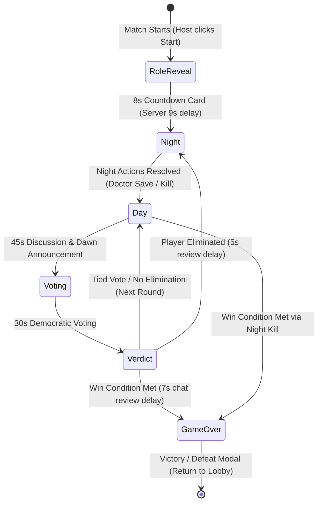

# 🕵️‍♂️ MafiaCorp

**MafiaCorp** is a real-time, cross-platform multiplayer social deduction game inspired by the Discord MafiaBot format. It features a high-performance **Java Netty** game engine, an **ASP.NET Core** backend with PostgreSQL, and a modern **.NET MAUI** cross-platform client (Android, Windows, iOS).

---

## 📑 Table of Contents

- [Features](#-features)
- [Architecture & Tech Stack](#-architecture--tech-stack)
- [Project Structure](#-project-structure)
- [Game Roles & Mechanics](#-game-roles--mechanics)
- [Game Phase Cycle](#-game-phase-cycle)
- [Prerequisites](#-prerequisites)
- [Local Development Setup](#-local-development-setup)
  - [1. Database & Web API](#1-database--web-api)
  - [2. Game Server (Java Netty)](#2-game-server-java-netty)
  - [3. Client App (.NET MAUI)](#3-client-app-net-maui)
  - [4. Single-Device Testing with AI Bots](#4-single-device-testing-with-ai-bots)
- [Remote Access & Tunneling](#-remote-access--tunneling)
- [Production Deployment (Docker & Oracle VPS)](#-production-deployment-docker--oracle-vps)
- [Network Protocol & Configuration](#-network-protocol--configuration)


---

## 🏛 Architecture & Tech Stack

```mermaid
graph TD
    subgraph Clients ["Client Layer"]
        A[".NET MAUI Android / Windows Client<br/>(C# / XAML / MVVM)"]
        B["Python Bot Simulator<br/>(simulate_bots.py)"]
    end

    subgraph Backend ["Backend & Networking"]
        C["ASP.NET Core Web API<br/>(Port 5130)<br/>Auth, User Stats, Match Records"]
        D["Java WebSocket Game Server<br/>(Port 54555 / $PORT)<br/>WebSocket Engine (RFC 6455)"]
        E[("PostgreSQL Database<br/>(Port 5432 / Neon.tech)")]
    end

    A -->|HTTP / REST (JWT)| C
    A -->|WebSocket wss://| D
    B -->|HTTP / REST| C
    B -->|WebSocket ws:// / wss://| D
    C -->|EF Core / Npgsql| E
    D -->|Internal Webhook POST| C
```

| Component | Technology | Description |
|---|---|---|
| **Client** | .NET MAUI (.NET 10), C#, CommunityToolkit.Mvvm | Mobile & desktop cross-platform game client |
| **API Backend** | ASP.NET Core, EF Core, PostgreSQL | User authentication, stats, and match persistence |
| **Game Server** | Java 21, Netty 4, Gson, Gradle | Low-latency TCP room-based game engine |
| **Testing** | Python 3 | Headless AI bot simulator for single-tester matches |
| **Deployment** | Docker, Docker Compose, Linux / Oracle Cloud VPS | Production containerized deployment stack |

---

## 📁 Project Structure

```text
MafiaCorp/
├── MafiaCorp.Api/              # ASP.NET Core Web API
│   ├── Controllers/            # Auth, Users, Stats, and Internal Match endpoints
│   ├── Data/                   # MafiaDbContext (PostgreSQL / EF Core)
│   ├── Models/ & DTOs/         # Database entities and API contracts
│   └── Program.cs              # API entry point & JWT configuration
├── MafiaCorp.Client/           # .NET MAUI Cross-Platform Application
│   ├── AppConfig.cs            # Host and port configuration
│   ├── Services/               # GameClientService (TCP socket), AuthService
│   ├── ViewModels/             # GameViewModel, HomeViewModel, LoginViewModel
│   └── Views/                  # GamePage, HomePage, LoginPage (XAML)
├── MafiaCorp.GameServer/       # Java Netty TCP Match Engine
│   ├── server/src/main/java/   # ConnectionManager, RoomManager, GameManager
│   ├── build.gradle            # Gradle configuration
│   └── gradlew / gradlew.bat   # Gradle wrapper
├── deploy/                     # Docker & Cloud Deployment
│   ├── docker-compose.yml      # Orchestration for DB, API, and Game Server
│   ├── Dockerfile.api          # Multi-stage build for .NET API
│   ├── Dockerfile.gameserver   # Multi-stage build for Java Server
│   └── setup_oracle_vps.sh     # Firewall & Docker automated setup script
├── simulate_bots.py            # Python script to inject automated bots
└── .gitignore                  # Git ignore rules for .NET, Java, and build artifacts
```

---

## 🎭 Game Roles & Mechanics

| Role | Faction | Abilities & Targeting Rules |
|---|---|---|
| **Mafia** | Mafia | Chooses a player to kill each night. Cannot target themselves. Shares visibility of fellow Mafia partners. |
| **Doctor** | Citizens | Protects one player each night from assassination. **Can** self-target (self-save). |
| **Detective** | Citizens | Investigates one player each night to uncover whether they are Mafia or Citizen. Cannot target themselves. |
| **Citizen** | Citizens | Has no night actions. Relies on daytime deduction, communication, and voting to eliminate the Mafia. |

### Win Conditions
- **Citizens Win**: When all Mafia members have been successfully eliminated.
- **Mafia Wins**: When the number of living Mafia members equals or exceeds the number of living Citizens.

---

## 🔄 Game Phase Cycle



---

## 📦 Prerequisites

Ensure you have the following installed on your development machine:

- **[.NET 9 or .NET 10 SDK](https://dotnet.microsoft.com/download)** with MAUI workload (`dotnet workload install maui`)
- **[Java JDK 21+](https://adoptium.net/)**
- **[PostgreSQL 16+](https://www.postgresql.org/download/)** (or Docker)
- **[Python 3.10+](https://www.python.org/)** (for `simulate_bots.py`)
- **[Android Studio](https://developer.android.com/studio)** or an Android device with Developer Mode / USB debugging enabled

---

## 🚀 Local Development Setup

### 1. Database & Web API

1. Start PostgreSQL (locally on port `5432` or via Docker):
   ```bash
   docker run --name mafiacorp-db -e POSTGRES_DB=MafiaCorpDB -e POSTGRES_USER=postgres -e POSTGRES_PASSWORD=SuperSecurePassword123! -p 5432:5432 -d postgres:16-alpine
   ```
2. Navigate to `MafiaCorp.Api`:
   ```bash
   cd MafiaCorp.Api
   dotnet run
   ```
   The API will listen at `http://localhost:5130`.  
   View Swagger documentation at: `http://localhost:5130/swagger`

---

### 2. Game Server (Java Netty)

In a new terminal window:
```bash
cd MafiaCorp.GameServer
# On Windows PowerShell:
.\gradlew run

# On Linux / macOS:
./gradlew run
```
The Game Server will start listening for TCP connections on port `54555`.

---

### 3. Client App (.NET MAUI)

1. Check `MafiaCorp.Client/AppConfig.cs` to ensure endpoints match your environment:
   ```csharp
   public static string ServerHost { get; set; } = "127.0.0.1"; // Or your LAN IP / VPS domain
   public static int GameServerPort { get; set; } = 54555;
   public static string ApiBaseUrl { get; set; } = "http://localhost:5130";
   ```
   > **Note for Android Emulators:** Android emulators map your host PC to `10.0.2.2`. For physical Android devices, use your local Wi-Fi IP (e.g., `192.168.1.x`) or a Cloudflare Tunnel.

2. Build and run the Android app:
   ```bash
   dotnet build MafiaCorp.Client/MafiaCorp.Client.csproj -f net10.0-android
   ```
   *(Or launch directly from Visual Studio / VS Code onto your emulator or device).*

---

## 🚢 Free Cloud Deployment (Render.com + Neon.tech — No Credit Card)

MafiaCorp includes a unified root `Dockerfile` that packages both the ASP.NET Core API and Java WebSocket Game Server behind an internal Nginx reverse proxy into **1 single free Web Service**.

### 1. Get Free PostgreSQL Database
1. Go to **[Neon.tech](https://neon.tech/)** and sign up (No credit card needed).
2. Create a project (`mafiacorp-db`) and copy the connection string.

### 2. Deploy on Render.com
1. Go to **[Render.com](https://render.com/)** and sign up with GitHub (No credit card needed).
2. Click **New +** $\rightarrow$ **Web Service** and select your MafiaCorp repository.
3. Render automatically detects the root `Dockerfile`. Set:
   - **Instance Type**: **Free**
   - **Environment Variables**:
     - `ConnectionStrings__DefaultConnection` = *(Your Neon.tech connection string)*
     - `InternalApiSecret` = `SuperSecretKeyForInternalJavaServer123!`
4. Click **Deploy Web Service**.

### 3. Keep Awake 24/7 (Prevent Sleep)
Render free containers sleep after 15 minutes of inactivity. Since 1 service running 24/7 uses only 744 of your 750 monthly free hours, you can keep it awake 24/7 permanently for free:
- Add a free monitor on **[cron-job.org](https://cron-job.org)** or **[UptimeRobot](https://uptimerobot.com)** pinging `https://<your-app>.onrender.com/health` every 10 minutes.

---

The Game Server uses a **JSON-over-TCP** framing protocol where each message is a single JSON line terminated by `\n`.

### Message Types
- `JOIN_ROOM`: Player handshake with room code, username, and user ID.
- `ROOM_STATE`: Full player list and readiness status.
- `ROLE_ASSIGNED`: Private role assignment sent to each client with teammate details.
- `PHASE_CHANGED`: Transition signal containing the new phase (`NIGHT`, `DAY`, `VOTING`), round count, and timer duration.
- `NIGHT_ACTION`: Targeted action (`KILL`, `PROTECT`, `INVESTIGATE`).
- `CAST_VOTE`: Target player ID voted by a player during daytime.
- `VOTING_RESULTS`: Vote tally breakdown with voter names.
- `PLAYER_ELIMINATED` / `PLAYER_DIED`: Casualty alerts with revealed roles.
- `GAME_OVER`: Winner declaration (`CITIZENS` or `MAFIA`).

---

## 📄 License

This project is licensed under the MIT License - feel free to modify and expand!

